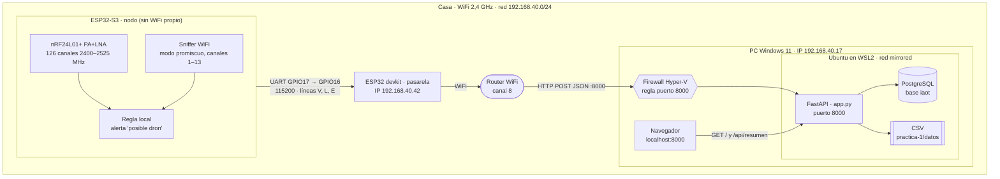
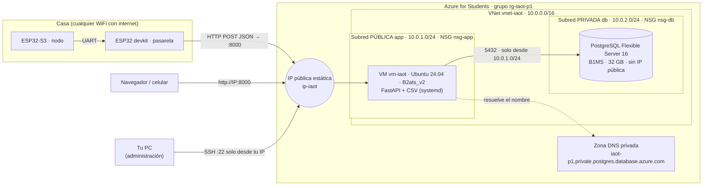
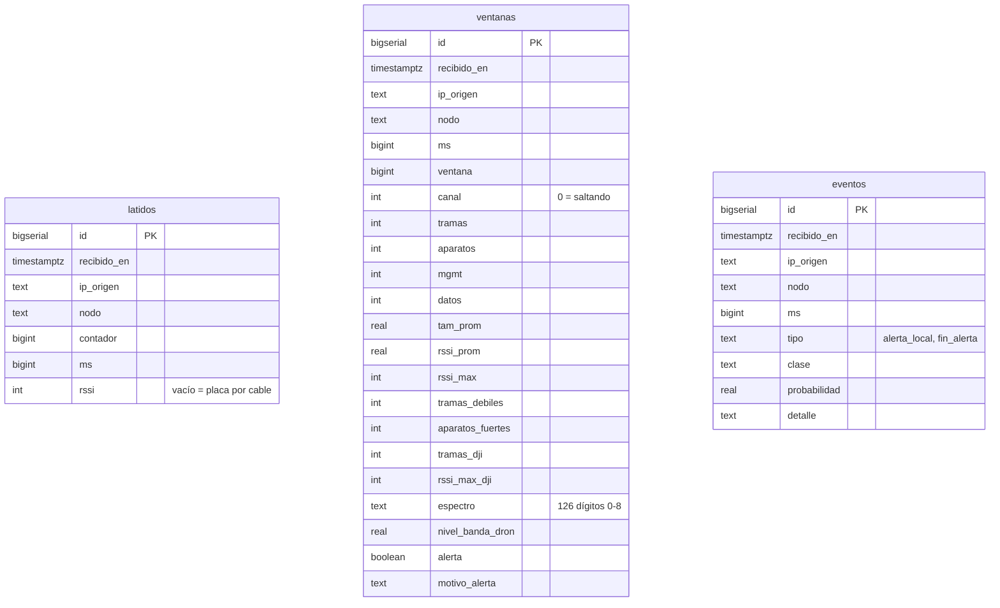

# Arquitectura — Práctica 1 (detector de drones)

Tres vistas del mismo sistema: cómo funciona hoy en local, cómo queda en Azure y qué guarda la base de datos. GitHub dibuja los diagramas solo (son Mermaid).

En las dos versiones las placas son las mismas: el **ESP32-S3** escucha y decide la alerta en el borde; el **ESP32 devkit** solo hace de pasarela. Lo único que cambia es a dónde apunta `SERVIDOR_IP`.

## 1. En local (funcionando)

📄 **Versión interactiva (Archify):** [arquitectura local](diagramas/arquitectura-local.html)

| Ruta | Quién la llama | Qué hace |
| --- | --- | --- |
| `POST /api/ventanas` | devkit, cada 2 s | Resumen WiFi + espectro; el servidor recalcula la alerta |
| `POST /api/latido` | devkit (el suyo y el del S3), cada 5 s | Saber que cada placa sigue viva |
| `POST /api/eventos` | devkit, cuando el S3 inicia o termina una alerta | Registrar la decisión tomada en el borde |
| `GET /`, `GET /api/resumen` | navegador | Página en vivo |

## 2. En la nube (Azure)

📄 **Versión interactiva (Archify):** [arquitectura en Azure](diagramas/arquitectura-nube.html)

**Reglas de seguridad**

| NSG | Regla | Origen | Puerto | Acción |
| --- | --- | --- | --- | --- |
| nsg-app | permitir-app-8000 | Internet | 8000/TCP | Permitir |
| nsg-app | permitir-ssh-mi-ip | Tu IP pública /32 | 22/TCP | Permitir |
| nsg-db | permitir-5432-desde-app | 10.0.1.0/24 | 5432/TCP | Permitir |
| nsg-db | negar-resto-vnet | VirtualNetwork | todos | Negar |

Scripts para crearlo: [`nube/`](nube/README.md).

## 3. Base de datos

📄 **Versión interactiva (Archify):** [base de datos](diagramas/base-de-datos.html)

Las tres tablas son independientes; se cruzan por `nodo` y por la hora de llegada. El mismo `esquema.sql` sirve en local y en Azure.

Cada fila se guarda también, con las mismas columnas, en `datos/latidos.csv`, `datos/ventanas.csv` y `datos/eventos.csv`.
