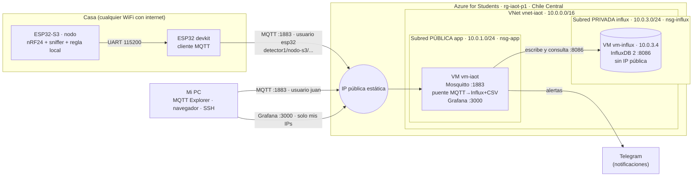

# Arquitectura de la Práctica 2

Las placas son las mismas de la Práctica 1. Lo que cambia es el protocolo: el devkit ya no hace HTTP POST, ahora publica por MQTT en un broker con usuario y clave. Un puente guarda cada mensaje en InfluxDB (series de tiempo, subred privada) y en CSV, y Grafana lo muestra y avisa por Telegram.

La "señal" del enunciado (temperatura y humedad) aquí es la del detector: el nivel de energía en la banda del dron (2423 a 2456 MHz) y los aparatos WiFi que escucha el nodo.

## Topics

Misma idea que `invernadero1/temperatura` del enunciado: `detector1/<placa>/<dato>`.

| Topic | Quién publica | Contenido | Se guarda |
| --- | --- | --- | --- |
| `detector1/nodo-s3/ventana` | devkit (lo que manda el S3) | JSON: tramas, aparatos, señal, espectro de 126 canales… | InfluxDB `ventanas` + `ventanas.csv` |
| `detector1/nodo-s3/nivel_banda` | devkit | número 0–8: energía en 2423 a 2456 MHz | no (para ver en vivo) |
| `detector1/nodo-s3/aparatos` | devkit | número: aparatos WiFi vistos | no (para ver en vivo) |
| `detector1/nodo-s3/latido` | devkit | JSON: contador y tiempo | InfluxDB `latidos` + `latidos.csv` |
| `detector1/nodo-s3/evento` | devkit | JSON: `alerta_local` o `fin_alerta` | InfluxDB `eventos` + `eventos.csv` |
| `detector1/pasarela-1/latido` | devkit | JSON con su señal WiFi | InfluxDB `latidos` + `latidos.csv` |
| `detector1/pasarela-1/estado` | devkit / broker (LWT) | `conectado` o `desconectado` (retenido) | no |

## Usuarios del broker

`allow_anonymous false`: sin usuario y clave no entra nadie. Cada usuario solo puede lo suyo ([`broker/acl`](broker/acl)).

| Usuario | Puede | Para |
| --- | --- | --- |
| `esp32` | publicar en `detector1/#` | la placa |
| `puente` | leer `detector1/#` | el servicio que guarda en InfluxDB y CSV |
| `juan` | leer y publicar en `detector1/#` | MQTT Explorer y pruebas |

## Reglas de seguridad

| NSG | Regla | Origen | Puerto | Acción |
| --- | --- | --- | --- | --- |
| nsg-app | permitir-app-8000 (Práctica 1) | Internet | 8000 | Permitir |
| nsg-app | permitir-ssh-mi-ip | Mis IPs /32 | 22 | Permitir |
| nsg-app | permitir-mqtt-1883 | Internet | 1883 | Permitir |
| nsg-app | permitir-grafana-mis-ips | Mis IPs /32 | 3000 | Permitir |
| nsg-influx | permitir-8086-desde-app | 10.0.1.0/24 | 8086 | Permitir |
| nsg-influx | permitir-ssh-desde-app | 10.0.1.0/24 | 22 | Permitir |
| nsg-influx | negar-resto-vnet | VirtualNetwork | todos | Negar |

InfluxDB va en una subred privada (el enunciado dice "pública", pero se mantiene privada como en la Práctica 1: nadie desde internet puede llegar a la base). Para administrarla se entra con un salto por SSH: `ssh -J juan@<IP pública> juan@10.0.3.4`.

## Qué se guarda en InfluxDB

Organización `uao`, bucket `detector`.

| Medición | Etiquetas | Campos |
| --- | --- | --- |
| `ventanas` | `nodo` | tramas, aparatos, mgmt, datos, tam_prom, rssi_prom, rssi_max, tramas_debiles, aparatos_fuertes, tramas_dji, rssi_max_dji, ventana, canal, ms, nivel_banda_dron, alerta, motivo_alerta |
| `latidos` | `nodo` | contador, ms, rssi |
| `eventos` | `nodo`, `tipo` | valor, ms, detalle |

## Alertas en Grafana

| Alerta | Se dispara cuando | Aviso |
| --- | --- | --- |
| Posible dron | el nivel en la banda del dron pasa de 2.5 en el último minuto | Telegram |
| Placa sin latidos | no llega ningún latido en 2 minutos (durante 1 minuto) | Telegram |
