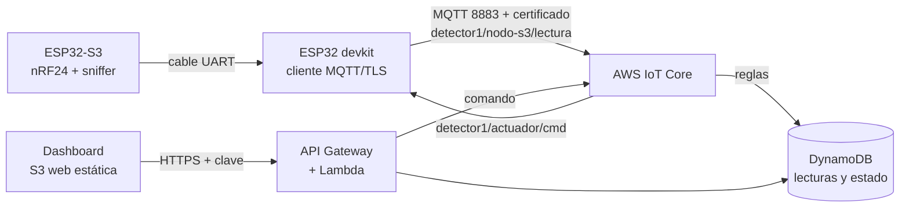

# Práctica 3 — Arquitectura serverless para IoT (AWS)

Enunciado: `Actividades/Actividad_3_2026-2.pdf`. Igual que en las Prácticas 1 y 2, la "señal" es la del detector de drones (nivel de energía en la banda 2423–2456 MHz y aparatos WiFi).

El enunciado habla de temperatura y humedad (DHT11/22); el profe autorizó orientar la práctica al proyecto del detector, así que aquí no se usa ese sensor.



Todo es *serverless*: no hay máquinas que mantener. Se crea con Terraform (`terraform/aws`).

> **Estado (2026-11-05):** desplegada en AWS Academy Learner Lab (`us-east-1`) y probada con el simulador y el dashboard.

## Qué hay en cada carpeta

| Carpeta | Qué tiene |
| --- | --- |
| `../terraform/aws/` | Terraform: IoT Core (cosa, certificado, política, reglas), DynamoDB, Lambda, API Gateway y el bucket S3 con el dashboard |
| `dashboard/` | `index.html`: gráfica, indicadores, botón del actuador y descarga de CSV |
| `esp32/devkit_aws/` | Firmware del devkit: publica por MQTT/TLS y escucha el comando del actuador |
| `simulador/` | `simular_aws.py`: hace de placa para probar sin hardware |
| `certs/` | (lo genera Terraform, no se sube a GitHub) certificados y datos de conexión |

## Topics

| Topic | Quién publica | Contenido |
| --- | --- | --- |
| `detector1/nodo-s3/lectura` | devkit, cada 5 s | JSON: `nivel_banda`, `aparatos`, `tramas`, `rssi_max`, `alerta` |
| `detector1/nodo-s3/evento` | devkit | JSON: `tipo`, `detalle` (alertas del S3) |
| `detector1/actuador/cmd` | dashboard (vía Lambda) | `{"estado":"on"}` o `{"estado":"off"}` |
| `detector1/actuador/estado` | devkit | `{"estado":"on|off"}` (confirmación) |

Las reglas de IoT Core copian lecturas y eventos a la tabla `iaot-p3-lecturas` y el estado del actuador a `iaot-p3-estado`.

## Paso a paso

### 0. Cuenta: AWS Academy Learner Lab

El profe te invitó al curso **AWS Academy Learner Lab [195977]** (correo del 24 de octubre, botón *Comenzar* → te registras en Canvas). Es el equivalente a Azure for Students, con estas reglas:

- No se pueden crear roles de IAM: el Terraform usa el rol que ya existe, `LabRole`.
- Solo sirven las regiones `us-east-1` y `us-west-2` (se usa `us-east-1`).
- Las credenciales **cambian cada vez** que inicias el laboratorio y duran unas horas.
- Hay un presupuesto (US$ 50). Esta práctica cuesta centavos, pero igual se borra al final.

### 1. Herramientas (una sola vez) — Ubuntu (WSL)

```bash
# AWS CLI
curl -s "https://awscli.amazonaws.com/awscli-exe-linux-x86_64.zip" -o /tmp/awscli.zip
unzip -q /tmp/awscli.zip -d /tmp && sudo /tmp/aws/install

# Terraform
wget -O- https://apt.releases.hashicorp.com/gpg | sudo gpg --dearmor -o /usr/share/keyrings/hashicorp.gpg
echo "deb [signed-by=/usr/share/keyrings/hashicorp.gpg] https://apt.releases.hashicorp.com $(lsb_release -cs) main" | sudo tee /etc/apt/sources.list.d/hashicorp.list
sudo apt update && sudo apt install -y terraform
```

### 2. Credenciales del laboratorio (cada vez que inicies) — Ubuntu (WSL)

1. En Canvas → curso *AWS Academy Learner Lab* → **Módulos → Learner Lab** → **Start Lab** (espera el punto verde).
2. Botón **AWS Details** → **AWS CLI: Show**. Copia las tres líneas.
3. Pégalas en `~/.aws/credentials`:
   ```bash
   mkdir -p ~/.aws && nano ~/.aws/credentials
   ```
   (el archivo empieza con `[default]`, luego `aws_access_key_id`, `aws_secret_access_key` y `aws_session_token`)
4. Prueba:
   ```bash
   aws sts get-caller-identity
   ```
   Debe mostrar tu cuenta. Si dice `ExpiredToken`, repite desde el paso 1 de esta lista.

### 3. Crear todo — Ubuntu (WSL)

```bash
cd ~/IAoT/terraform/aws        # o la ruta donde esté tu repo
terraform init
terraform plan                 # lee lo que va a crear (unos 30 recursos)
terraform apply                # escribe "yes"
```

Al terminar imprime `dashboard_url`, `api_url` e `iot_endpoint`. La clave del dashboard:

```bash
terraform output -raw token_api
```

Además genera (fuera de git) `practica-3/certs/*` y `practica-3/esp32/devkit_aws/certs.h`.

### 4. Probar sin placa: simulador — Ubuntu (WSL)

```bash
pip install --break-system-packages "paho-mqtt>=2,<3"     # una vez
cd ../../practica-3/simulador
python3 simular_aws.py --dron
```

Abre el `dashboard_url`, escribe la clave y verás la gráfica. Pulsa **Encender**: en la terminal del simulador debe aparecer `>>> ACTUADOR ENCENDIDO`.

Evidencia de que la base guarda (criterio de *Funcionalidad*):

```bash
aws dynamodb scan --table-name iaot-p3-lecturas --max-items 3 --region us-east-1
```

### 5. La placa real

1. Arduino IDE → Gestor de librerías → instala **PubSubClient**.
2. Copia `esp32/devkit_aws/secrets.h.example` como `secrets.h` y pon tu WiFi (2,4 GHz).
3. Abre `devkit_aws.ino` (junto a `certs.h`, que ya generó Terraform) y súbelo al devkit (ESP32 Dev Module, BOOT apretado al conectar).
4. En el Monitor Serie debe salir `Poniendo la hora ... OK` y luego `Conectando a AWS IoT ... OK (escuchando comandos)`.

Si sale `fallo (estado -2)`: revisa WiFi y hora. Si sale `estado 5`: el certificado no está activo o la política no está adjunta (`terraform apply` otra vez).

### 6. Dashboard

- Gráfica de nivel de la banda del dron y aparatos, con rango de 15 min a 24 h.
- Indicadores y estado de la placa (en línea / sin reportar).
- **Actuador**: botón que manda el comando a la placa y muestra su confirmación.
- **Descargar CSV**: baja las lecturas guardadas en DynamoDB.
- Se publica en S3 como web estática (`dashboard_url`).

### 7. Cuando termines — Ubuntu (WSL)

```bash
cd ~/IAoT/terraform/aws
terraform destroy
```

## Checklist del enunciado

- [ ] Caso de uso definido: detector de drones (orientación autorizada por el profe en lugar de temperatura y humedad).
- [ ] AWS IoT configurado (cosa, certificado, política).
- [ ] ESP32 enviando por MQTT al servicio AWS IoT.
- [ ] Datos en DynamoDB (verificados con `aws dynamodb scan`).
- [ ] Dashboard con control de actuador y descarga de CSV.
- [ ] Dashboard publicado en un bucket S3 como web estática.
- [ ] Repositorio con código, README y paso a paso.
- [ ] Presentación.

## Límites conocidos

- El sitio de S3 se sirve por HTTP (sin cifrar); la clave del dashboard viaja a la API por HTTPS, pero la página en sí no. La mejora es poner CloudFront con HTTPS (en Learner Lab puede no estar permitido).
- La clave del dashboard es una sola, compartida. Para varios usuarios se usaría Cognito.
- En Learner Lab el recurso `aws_s3_bucket` falla (una política del laboratorio niega `s3:GetBucketObjectLockConfiguration`), por eso el bucket se crea con el AWS CLI desde Terraform (`terraform_data.bucket_web`).
