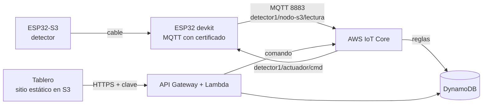

# Práctica 3. Arquitectura serverless para IoT en AWS

Enunciado: Actividad 3 de 2026-2. Igual que en las prácticas anteriores, la señal es la del detector de drones y no el DHT del enunciado, con permiso del profesor. Todo es serverless (no hay máquinas que mantener) y se crea con Terraform desde [`terraform/aws`](../terraform/aws).



La desplegué y probé el 5 de noviembre en AWS Academy Learner Lab (`us-east-1`), con el simulador y el tablero. Desde el 10 de noviembre, con `nodo_detector` en el S3, cada lectura lleva también la clase y la probabilidad que da el modelo, y la alerta es la del modelo en lugar del umbral fijo.

## Piezas

| Carpeta | Contenido |
| --- | --- |
| `../terraform/aws/` | IoT Core (cosa, certificado, política y reglas), DynamoDB, Lambda, API Gateway y el bucket del tablero |
| `dashboard/` | El tablero: gráfica, indicadores, clasificación del modelo, botón del actuador y descarga en CSV |
| `esp32/devkit_aws/` | Firmware del devkit que publica por MQTT con TLS y escucha el comando del actuador |
| `simulador/` | `simular_aws.py`, para probar sin placa |

Hoy el firmware recomendado para el devkit es `firmware/devkit_centinela`, que hace lo mismo que `devkit_aws` y además sirve la app del celular.

## Topics

| Topic | Lo publica | Contenido |
| --- | --- | --- |
| `detector1/nodo-s3/lectura` | devkit, cada 5 s | `nivel_banda`, `aparatos`, `tramas`, `rssi_max`, `alerta`, `clase`, `prob_dron` |
| `detector1/nodo-s3/evento` | devkit | `tipo` y `detalle` de las alertas del S3 |
| `detector1/actuador/cmd` | tablero, a través de la Lambda | `{"estado":"on"}` u `{"estado":"off"}` |
| `detector1/actuador/estado` | devkit | La confirmación del actuador |

Las reglas de IoT Core copian lecturas y eventos a la tabla `iaot-p3-lecturas` y el estado del actuador a `iaot-p3-estado`.

## Pasos

El Learner Lab tiene sus reglas: no deja crear roles de IAM (se usa `LabRole`), solo sirven `us-east-1` y `us-west-2`, las credenciales cambian cada vez que se inicia y hay un presupuesto de 50 USD.

Herramientas, una sola vez en Ubuntu (WSL):

```bash
curl -s "https://awscli.amazonaws.com/awscli-exe-linux-x86_64.zip" -o /tmp/awscli.zip
unzip -q /tmp/awscli.zip -d /tmp && sudo /tmp/aws/install
wget -O- https://apt.releases.hashicorp.com/gpg | sudo gpg --dearmor -o /usr/share/keyrings/hashicorp.gpg
echo "deb [signed-by=/usr/share/keyrings/hashicorp.gpg] https://apt.releases.hashicorp.com $(lsb_release -cs) main" | sudo tee /etc/apt/sources.list.d/hashicorp.list
sudo apt update && sudo apt install -y terraform
```

Cada vez: en Canvas, Learner Lab → Start Lab; luego AWS Details → AWS CLI: Show, y pegar las tres líneas en `~/.aws/credentials`. `aws sts get-caller-identity` debe mostrar la cuenta.

```bash
cd terraform/aws
terraform init
terraform apply
terraform output -raw token_api      # clave del tablero
```

`apply` imprime `dashboard_url`, `api_url` e `iot_endpoint`, y deja fuera de git los certificados en `practica-3/certs/` y el `certs.h` de los dos firmwares del devkit.

Sin placa:

```bash
pip install --break-system-packages "paho-mqtt>=2,<3"
cd practica-3/simulador
python3 simular_aws.py --dron
```

En el tablero, el botón Encender debe hacer aparecer `>>> ACTUADOR ENCENDIDO` en el simulador. Para ver que DynamoDB guarda: `aws dynamodb scan --table-name iaot-p3-lecturas --max-items 3 --region us-east-1`.

Con la placa: instalar PubSubClient, copiar `secrets.h.example` como `secrets.h` con el WiFi y subir el sketch. En el Monitor Serie debe salir `Conectando a AWS IoT ... OK`. Un `estado -2` suele ser WiFi u hora; un `estado 5`, el certificado o la política (`terraform apply` otra vez).

Al terminar: `terraform destroy` en la misma carpeta.

## Límites

- El tablero se sirve por HTTP desde S3. La clave viaja a la API por HTTPS, pero la página no; la solución sería CloudFront con HTTPS, que el Learner Lab puede no permitir.
- La clave del tablero es una sola. Para varios usuarios habría que usar Cognito.
- En el Learner Lab el recurso `aws_s3_bucket` falla por una política del laboratorio, así que el bucket se crea con la CLI desde Terraform (`terraform_data.bucket_web`).
